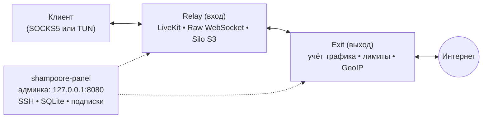
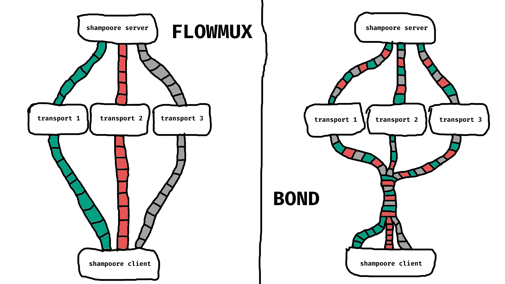

<p align="center">
  
</p>

<h1 align="center">shampoore</h1>

<p align="center">
  <em>Модульная платформа для прокси-туннелирования поверх кастомных сервисов.</em>
</p>

<p align="center">
  <a href="https://github.com/Esteviredzu/shampoore/releases"></a>
  <a href="https://go.dev/"></a>
  <a href="https://github.com/Esteviredzu/shampoore/blob/main/LICENSE"></a>
</p>

<p align="center">
  <a href="#архитектура">Архитектура</a> •
  <a href="#транспорты">Транспорты</a> •
  <a href="#агрегация-каналов">Агрегация (flowmux & bond)</a> •
  <a href="#быстрый-старт">Установка</a> •
  <a href="#клиент-и-android-sdk">Клиент и Android SDK</a>
</p>

> **Дисклеймер:** проект предоставляется «как есть» для исследовательских и образовательных целей. Автор не несёт ответственности за использование в нарушение законодательства или условий сторонних сервисов. Используя код, вы берёте ответственность на себя.

---

## Обзор

**shampoore** - это туннель, который прячет трафик внутрь запросов к публичным API, и не только. Снаружи выглядит как обычный заход на сайт, S3-хранилище или звонок, а внутри едет интернет трафик.

В комплекте:
* **`shampoore-server`** - демон выходной ноды (Exit);
* **`shampoore-panel`** - веб-панель управления (админка, подписки, деплой по SSH);
* **`shampoore-relay`** - входной сервер (Relay);
* **`shampoore-node-agent`** - фоновый агент на выходной ноде;
* **`shampoore-client`** - CLI-клиент (`SOCKS5` / `TUN`);
* **`shampoore.aar`** - Android SDK.

---

## Архитектура



* **Входные серверы (Relay)** принимают клиентов через общие транспорты.
* **Выходные серверы (Exit)** считают трафик по каждому пользователю, проверяют лимиты и срок подписки, блокируют трафик по GeoIP-правилам и пускают его в интернет.
* **Агент ноды** раз в 30 секунд отправляет дельты трафика и обновляет список активных пользователей на Exit.
* **Панель управления (`shampoore-panel`) полностью независима от нод** — её можно поставить на любой отдельный сервер или даже на домашний Linux-ПК. Из панели входные и выходные ноды раскатываются на нужные VPS по SSH в пару кликов. Если у машины с панелью нет белого IP, не будут работать только онлайн-подписки по ссылке, но оффлайн-бандлы (`shampoore://`) можно передавать на устройства вручную.

---

## Транспорты

Транспорт - это способ, которым трафик выходит наружу. Внутри всё одинаково: мультиплексор, шифрование, надёжная доставка. Меняется только то, как пакеты едут по сети:

| Транспорт | Описание |
| :--- | :--- |
| **`yandex`** | Трафик упаковывается в запросы к публичному Socket.IO API Яндекс Доски. |
| **`yandex_telemost_raw`** | Данные обзаводятся заголовками VP8 и идут как видео в звонке. |
| **`yandex_telemost_squares`** | Создаёт реальный видеопоток с сеткой квадратов, в которые закодирован трафик. |
| **`livekit_datachannel`** | Трафик поверх LiveKit DataChannel. |
| **`silo`** | Данные складываются как объекты в S3-хранилище. Клиент пишет объект, сервер читает, и наоборот. |
| **`multi`** | Агрегатор, собирает несколько транспортов в один канал. Умеет работать в режимах `flowmux` и `bond`. |
| **`raw_ws`** | Трафик внутри WebSocket (`TLS in TLS`). Для маскировки паттерна используется паддинг и батчинг, а также сайт-заглушка. |

---

## Агрегация каналов

Когда транспортов больше одного, трафик нужно как-то между ними распределить. В проекте два режима, и они решают разные задачи.

<p align="center">
  
</p>

### `flowmux`
Размазывает потоки между транспортами. У каждого транспорта своя задержка и пропускная способность, поэтому `flowmux` считает для каждого `score` и отправляет новые потоки туда, где сейчас лучше. Если транспорт начинает тупить, его `score` проседает, и трафик уходит на соседей. Быстрый, если много параллельных соединений.

### `bond`
Склеивает несколько транспортов в один канал. Чанки нумеруются, подтверждаются по `ack`, потерянные ретранслируются через любую живую трубу. Если один транспорт умер, `bond` перестаёт его использовать. Теоретически даёт сумму скоростей - идеальный вариант, но мы не в идеальном мире. По факту иногда ведёт себя непредсказуемо и проседает по скорости, но это уже совсем другая история.

---

## GeoIP-правила

На выходных серверах можно блокировать трафик по географии. Правила добавляются двумя способами:
* **вручную** - вставить список CIDR/IP;
* **по ссылке** - панель скачает список и будет обновлять его с заданным интервалом.

Ещё правила можно привязать галочками к конкретным Exit-серверам, чтобы на разных нодах работали разные списки.

Готовая ссылка для российских IPv4-подсетей:

```text
https://github.com/ipverse/country-ip-blocks/blob/master/country/ru/ipv4-aggregated.txt
```

---

## Быстрый старт

Поддерживаются системы на базе Linux с `systemd`.

```bash
curl -fsSL https://github.com/Esteviredzu/shampoore/releases/latest/download/install.sh | sudo bash
```

Скрипт сам создаст пользователя `shampoore`, положит бинарники в `/opt/shampoore/bin`, сгенерирует токен доступа и запустит `systemd`-сервис с автозапуском.

### Доступ к панели

После установки панель слушает только `127.0.0.1:8080`, снаружи её не видно. Заходить нужно через SSH-туннель:

```bash
ssh -L 8080:127.0.0.1:8080 user@server
```

Дальше открываете `http://127.0.0.1:8080` и попадаете в панель.

<details>
<summary><strong>Удаление</strong></summary>

```bash
sudo /opt/shampoore/uninstall.sh --purge
```

Флаг `--purge` зачищает всё: бинарники, сервис, конфиги, состояние и системного пользователя. Если хотите сохранить конфиги, запустите скрипт без флага.
</details>

---

## Клиент и Android SDK

### CLI-клиент

Клиент принимает JSON-файл или URL формата `shampoore://`.

```bash
# SOCKS5-прокси, по умолчанию на 127.0.0.1:1080
shampoore-client -c config.json -m socks5

# VPN (TUN)
sudo shampoore-client -c shampoore://... -m tun
```

### Android SDK

Для мобильных приложений доступна скомпилированная библиотека AAR. Скачайте `shampoore.aar` из раздела Releases и положите в `app/libs/`.

```kotlin
// app/build.gradle.kts
implementation(files("libs/shampoore.aar"))
```

Минимальный пример:

```kotlin
import mobile.Mobile

// Запуск в режиме VPN, передав файловый дескриптор TUN
val err = Mobile.startClientVPN(configUrl, tunFd, 1500)
if (err.isNotEmpty()) {
    // Обработка ошибки
}

// Статистика
val statsJson = Mobile.getStats()
```

Полный пример и описание методов в [advanced.md](advanced.md).

---

## Техническая документация

Флаги запуска, ручная сборка, внутренности control-сокета, полный Android SDK и другие детали лежат в [advanced.md](advanced.md).

---

<sub> Я вдохновился [olcrtc](https://github.com/openlibrecommunity/olcrtc) и [OpenFlux](https://github.com/p1neapplexpress/OpenFlux) и захотел наколхозить что-то своё.</sub>
